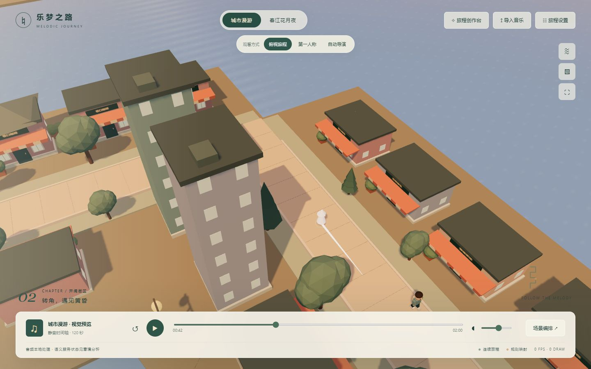

# 乐梦之路 · Melodic Journey

一个可编辑的音乐视觉旅程 Demo：让小观察者沿连续道路走过城市与诗意风景，将音乐、歌词、场景和观看方式组织成一段可以调整、保存和重播的旅程。



当前版本：`0.1.0-rc.1`，MIT。桌面浏览器优先。基础预览与编辑不需要模型、账号或 API 密钥；自动语义分析与逐曲创作是可选实验功能。

## 五分钟开始

需要 Node.js 24 与 pnpm 11.25.0。先安装这些开发工具，再在源码目录运行：

```sh
pnpm install --frozen-lockfile
pnpm dev
```

打开终端显示的本地地址（通常为 `http://127.0.0.1:5173`）。不要直接双击 `index.html`。

1. 无需上传文件，先播放「城市漫游」或「春江花月夜」静音预览。
2. 在「旅程设置」调整观察者、速度、环境色调与密度；在「场景编排」编辑章节和转角。
3. 切换俯视或观察者第一人称，尝试暂停、拖动进度和重播。
4. 选择「导入音乐」加载自己的 MP3/WAV，再导入 LRC 或粘贴歌词。
5. 在「旅程设置」保存到本机，或导出 JSON；导入同一 JSON 可恢复编排。

### 沉浸观看与截图

顶部「精选示例」提供找回的 **夜雨酒馆 · 江畔金桂** 静音样段：29 秒酒馆、74 秒金桂。可查看只读原版、复制并编辑，也可将自己的旅程保存为独立版本并导出备份。它是人工编排示例，未附带《成都》录音或歌词。详见[精选示例与保存说明](docs/featured-examples.md)。

点击右侧「沉浸模式」会隐藏 Logo、标题和设置，并尝试进入全屏。视角、播放条和退出操作移到右下角，可收起为小按钮。浏览器不允许全屏时仍可使用页面沉浸。

- `H`：隐藏／恢复全部控件；隐藏后也可单击画面恢复。
- `1 / 2 / 3`：俯视／第一人称／自动导演；暂停时切换保持同一时刻。
- 空格：播放／暂停（操作滑块或按钮时保留控件原有键盘行为）。
- `Esc` 或「退出沉浸」：恢复主界面。歌词可在角落面板单独显示。

截图时先暂停，再隐藏控件，用 `1 / 2` 切换视角。它只改变观看方式，不重新生成旅程。

没有模型服务时，自动分析会明确降级为声学预编排。仍可以播放、编辑和保存；不把降级结果称为歌词理解。

## 已有能力

- 连续道路、自动行进与转弯；空间速度和停留不改变音频播放速度。
- 本地音频播放、能量与起音分析、LRC 时间基准与偏移、当前字幕。
- 俯视与第一人称共享世界，昼夜、天气、水面、灯光及章节过渡。
- 编辑章节、场景、步速、种子、构件和氛围；导入导出计划和可复用内容。
- 三层库：场景决定空间规则，氛围决定光色与天气，组件提供对象和能力；基础库包含 5 个世界、9 个氛围、48 个基础组件。
- 可选本地模型分析、原始依据审阅、人工残差修正，以及逐曲创作提案和五阶段重点桥段。

## 可选模型服务

基础 Demo 无需配置此节。需要歌词语义与自动创作时，把 `.env.example` 复制为 `.env.local`，填写已经安装的 Ollama 模型名称和服务地址，重启 `pnpm dev`。

```dotenv
NARRATIVE_PROVIDER=ollama
NARRATIVE_BASE_URL=http://127.0.0.1:11434
NARRATIVE_MODEL=你的已安装模型名称
CREATIVE_MODEL=你的已安装创作模型名称
```

本仓库不捆绑或自动下载模型。配置兼容远程服务时，歌词和声学摘要会发送给该服务；音频文件本身不随分析请求上传。不要将密钥放入以 `VITE_` 开头的变量或提交 `.env.local`。

## 数据与边界

- 默认城市与诗意预览是能力样例，不是某首商业歌曲的自动生成结果。
- 当前不附带商业音乐、用户录音或完整商业歌词。请使用你有权使用的素材。
- 音频留在浏览器，计划 JSON 不包含录音；刷新后需重新选择音频。
- 纯文本歌词按粗略时间分配；起音不是精确拍点，声学摘要不是主旋律识别。
- 自动导演仍属实验：语义、必要画面和艺术质量可能不一致。列车、动物、烟花、流星与跨世界梦境等长期愿景尚未完整实现。
- 本版本不承诺任意歌曲都能生成成熟作品，不包含面向用户的视频导出。

## 构建与检查

```sh
pnpm test
pnpm check:architecture
pnpm build
pnpm preview
```

这里的测试是独立于历史交接资料的 MVP 核心检查，不等于原开发仓库的完整测试集。

`dist/` 可交给静态服务器托管，支持相对资源路径。静态托管只有预览、编辑和本地音频等前端能力；可选模型接口需要运行 Vite 开发服务或另行部署服务端，不会因上传到 GitHub 自动获得 AI 能力。

## 结构与贡献

Vite + TypeScript + Three.js，保持模块化单体。`src/domain` 为数据与规则，应用编排通过适配器连接模型和存储，渲染器负责共享世界及播放。内容继续使用场景／氛围／组件三层，不执行模型生成的任意 JavaScript。

一次贡献围绕一个可观看或可操作的结果，附最小复现及对应检查；不要用歌曲名特例、降低校验门槛或新增抽象代替功能完成。

版本来源见 [SOURCE.json](SOURCE.json)，运行核验见 [VALIDATION.json](VALIDATION.json)。本公开候选从已验证源码节点导出，未携带原开发仓库的聊天交接记录、模型权重和 Git 历史。

## 许可证

项目代码使用 [MIT](LICENSE)。依赖和第三方内容保留各自许可，见 [THIRD_PARTY_NOTICES.md](THIRD_PARTY_NOTICES.md)。本项目的许可证不授予任何用户上传音乐或歌词的权利。
