<h1 align="center">乐梦之路 · Melody Dream Journey</h1>

<p align="center"><strong>给我一首歌的时间。给我一首歌，还你一段梦。</strong></p>
<p align="center">让旋律有路可走，让小小的旅人，替你走进歌里的风景。</p>
<p align="center"><a href="README.md">English</a> · <strong>简体中文</strong></p>
<p align="center"><a href="#沿途有些风景">沿途风景</a> · <a href="#从这里出发">快速开始</a> · <a href="#把旅程写成自己的模样">开始创作</a> · <a href="#路还会延伸">未来方向</a> · <a href="LICENSE">MIT</a></p>

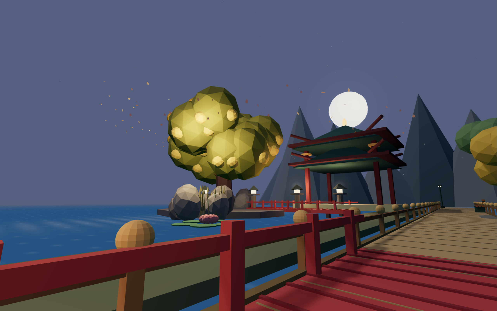

有些歌听完以后，会留下一处地方。是夕阳还没落尽的街口，是雨里的一盏暖灯，也是想在树下多站一会儿的那个夜晚。

**乐梦之路**想给这些地方一个可以走进去的小世界。一个小小的旅人，沿着连续的道路，走过微缩街巷与月下水岸。你可以在高处看他的旅程，也可以借他的眼睛看风景，或让镜头自己寻找角度。带上自己的音乐，调整沿途的光和景，把喜欢的片刻保存下来。

当前发布的是一个**可编辑的浏览器 Demo**：内置旅程、本地音频、场景编辑、沉浸观看和示例保存均不需要账号、API 密钥或模型。逐曲意境理解与自动电影化导演是可选的实验功能。应用界面目前为中文，README 提供中英文版本。

## 现在可以做什么

| 想体验的事 | 当前 Demo 的能力 |
| --- | --- |
| 跟着一首歌走一段路 | 播放本地 MP3/WAV，导入 LRC 歌词，拖动时间轴，在连续道路上安排章节。 |
| 从不同角度看同一个世界 | 俯视与第一人称共享世界和时间轴，也可选择自动镜头。 |
| 为风景添上自己的情绪 | 调整光线、天气、服装、步速、布局种子、章节、组件与氛围。 |
| 让画面只剩风景 | 进入沉浸模式，收起角落控件，或全部隐藏，截取干净画面。 |
| 留住值得重看的旅程 | 查看精选原版，复制后编辑，保存命名版本，导出或恢复示例包。 |

## 沿途有些风景

以下均为 Demo 实际运行截图，按场景把同组机位并排展示，可打开图片查看大图。它们展示当前可以编排与回放的画面，不代表任意歌曲都会自动得到同等效果。

### 街巷，还留着一点夕阳

沿着暖色的屋檐与熟悉的街角，跟上小旅人的脚步。从微缩俯视切换到街头，不需要重新生成世界。

<table>
  <tr><td width="33%">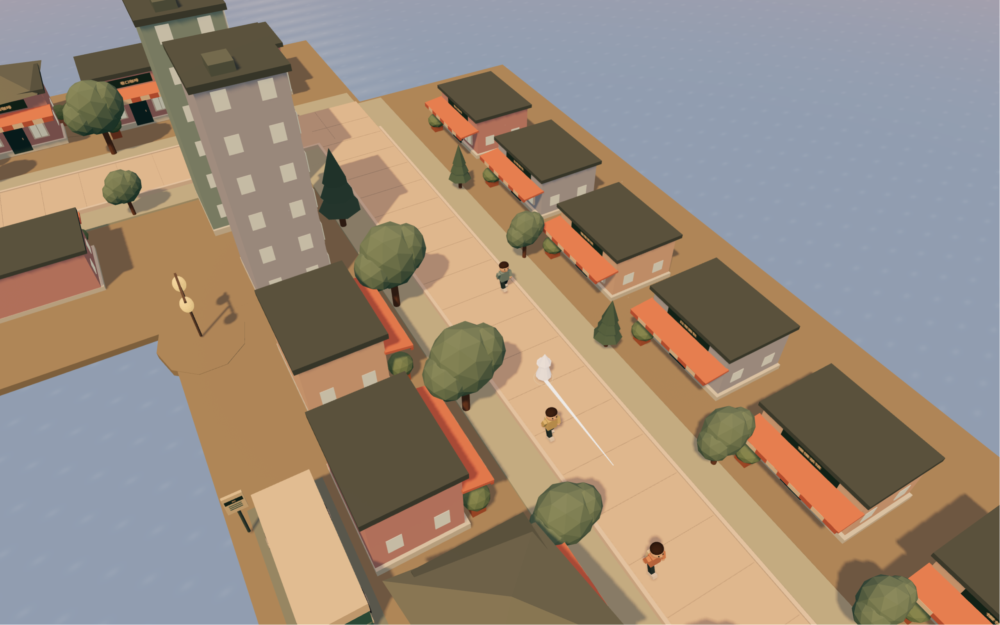</td><td width="33%">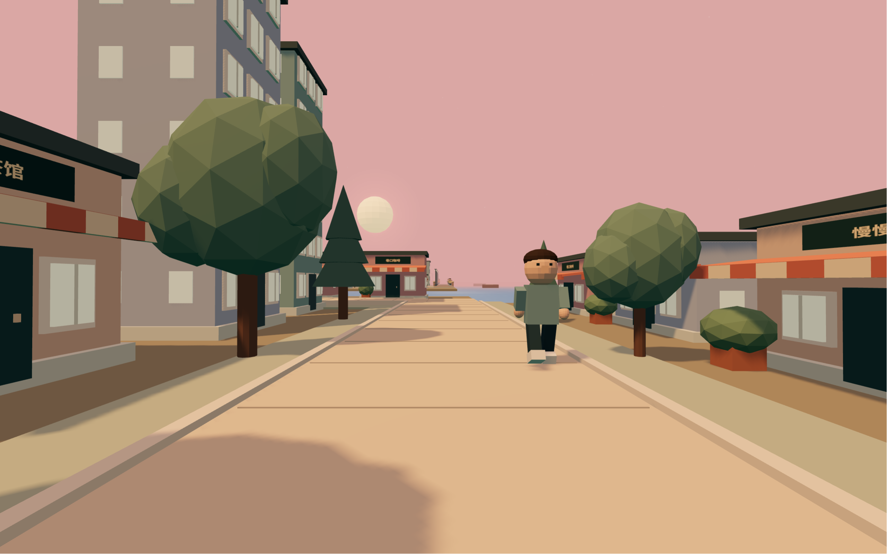</td><td width="33%">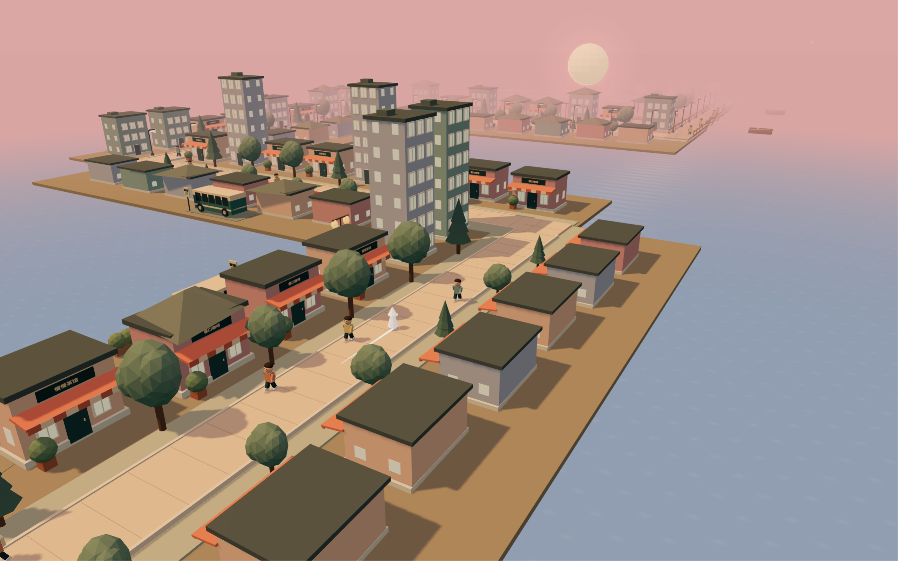</td></tr>
  <tr><td align="center">从街巷上方</td><td align="center">借旅人的眼睛</td><td align="center">看路向远方延伸</td></tr>
</table>

### 夜色里，窗户一盏盏亮起

夕阳之后，是路灯接过了光。通过章节编排与氛围设置，让一段旅程在行进中转换光色与心情。

<table>
  <tr><td width="33%">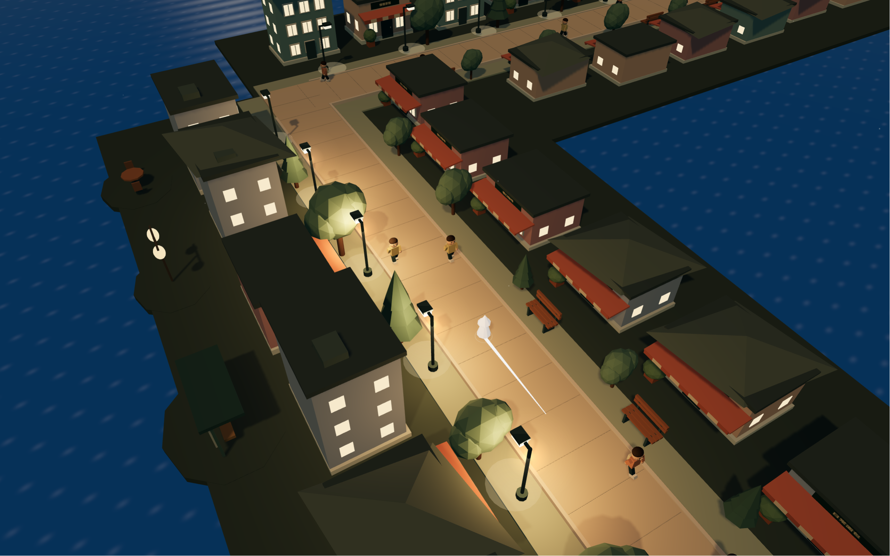</td><td width="33%">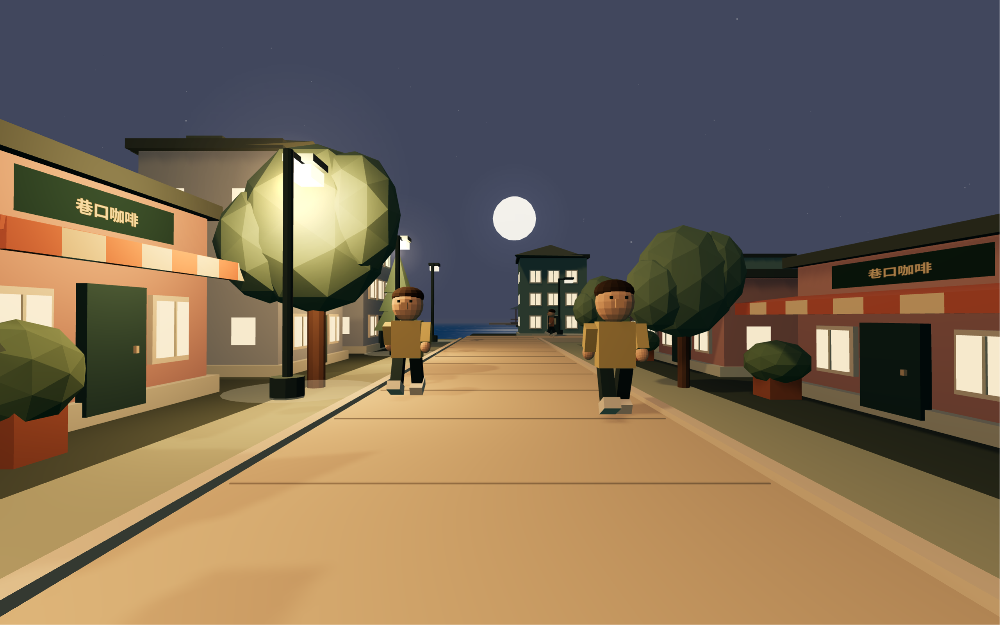</td><td width="33%">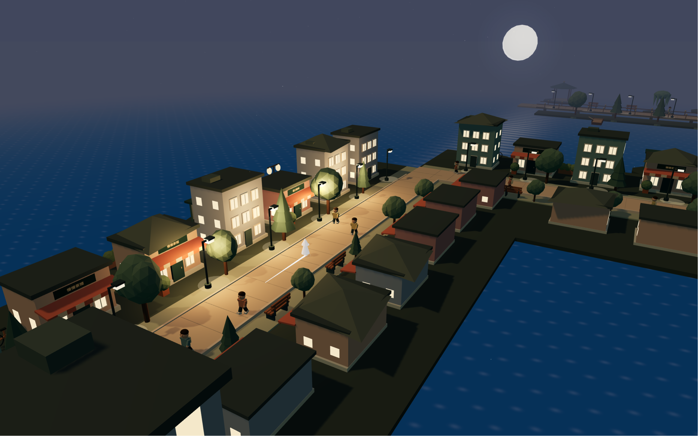</td></tr>
  <tr><td align="center">沿着一串暖灯</td><td align="center">走过熟悉的街角</td><td align="center">看整座小城入夜</td></tr>
</table>

### 花树临水，月亮陪你走一程

连续的水岸小径，花树、长椅和远处的亭子。暂停时间轴，再切换视角，为同一处风景找到喜欢的构图。

<table>
  <tr><td width="33%">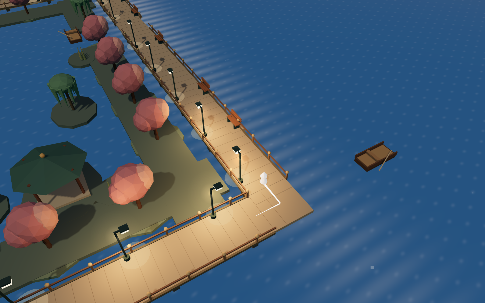</td><td width="33%">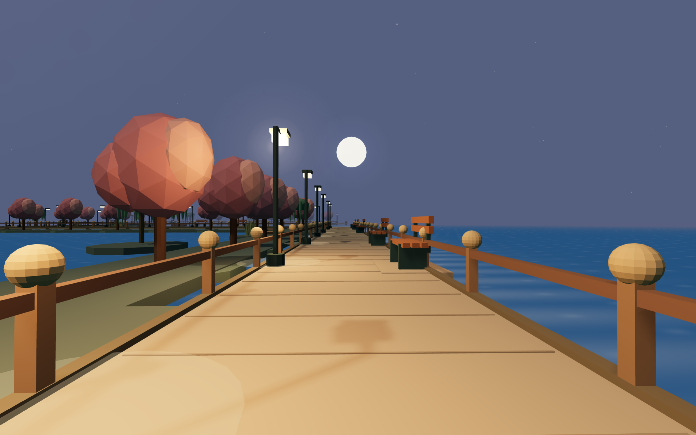</td><td width="33%">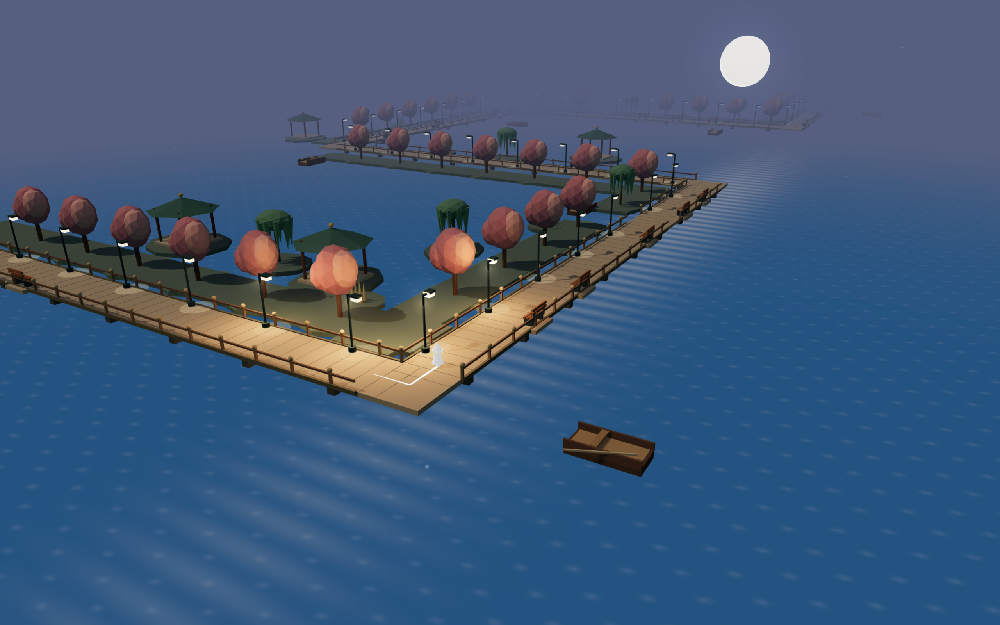</td></tr>
  <tr><td align="center">水边的一个转角</td><td align="center">花树就在身旁</td><td align="center">月光里的小小世界</td></tr>
</table>

### 雨还在下，先在暖灯里坐一会儿

精选酒馆段落让旅人走进室内，停留、环顾。俯视时屋顶让开，便于看清房间；第一人称则来到桌旁，让门外的雨衬出屋里的暖。

<table>
  <tr><td width="33%">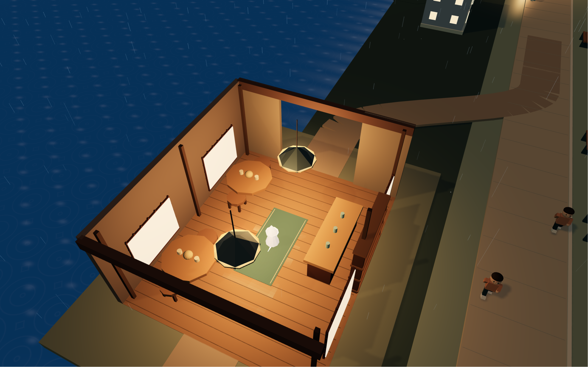</td><td width="33%">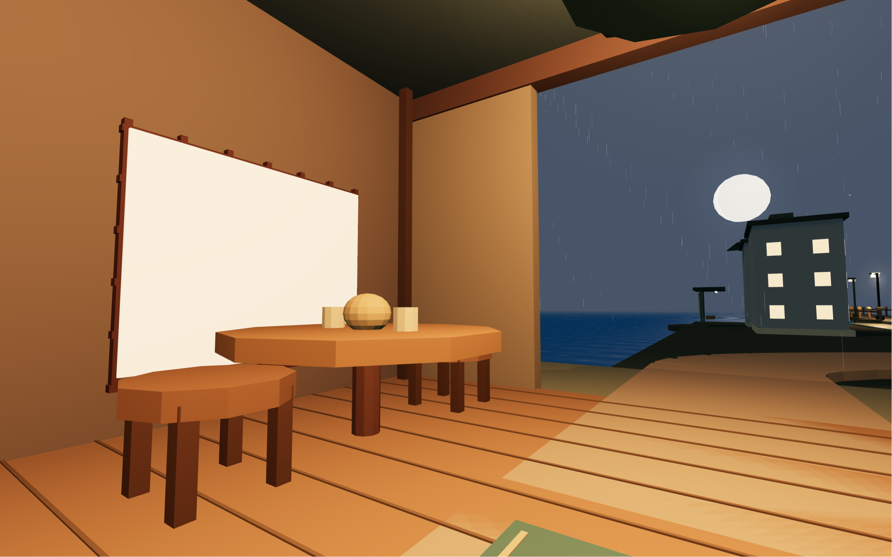</td><td width="33%">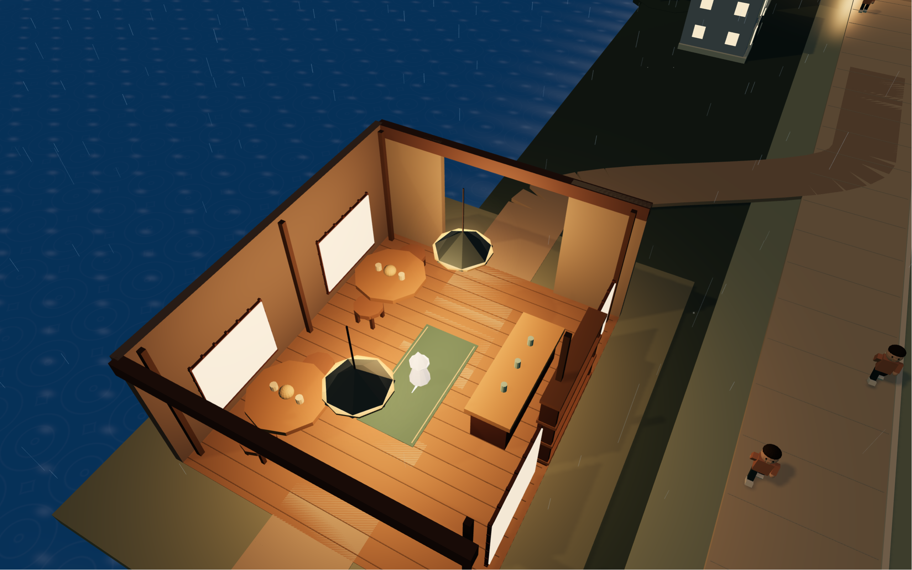</td></tr>
  <tr><td align="center">路边的一间小店</td><td align="center">门外有雨，屋里有光</td><td align="center">再看一眼这个房间</td></tr>
</table>

### 在金桂树下，再停留片刻

离开酒馆，红桥把目光引向一株开花的金桂与月亮。这是已保存的**「夜雨酒馆 · 江畔金桂」**示例中的第二个亮点。

<table>
  <tr><td width="50%">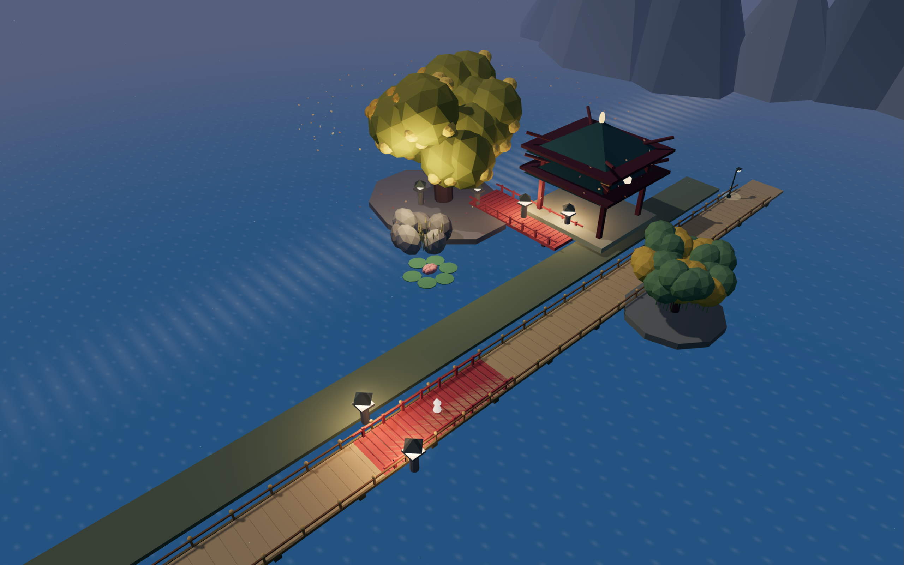</td><td width="50%"></td></tr>
  <tr><td align="center">桥上，小小的旅人</td><td align="center">树下，想多留一会儿</td></tr>
</table>

精选示例是 **96 秒人工编排的静音旅程**，可跳到 **29 秒酒馆**与 **74 秒金桂**。它未附带《成都》录音或歌词，也不作为自动歌曲理解效果的证明。

## 从这里出发

先安装 **Node.js 24** 与 **pnpm 11.25.0**，然后运行：

```sh
git clone https://github.com/Gary-CF/Melody-Dream-Journey.git
cd Melody-Dream-Journey
pnpm install --frozen-lockfile
pnpm dev
```

打开 Vite 在终端显示的本地地址，通常为 `http://127.0.0.1:5173`。推荐使用支持 WebGL 的桌面浏览器；请通过本地服务打开，不要直接双击 `index.html`。

第一次来，可以先打开**精选示例 → 查看原版**，跳到两个亮点，播放或进入沉浸模式。**返回主页**可以回到主界面；**复制并编辑**会打开一个独立的可编辑副本。

## 把旅程写成自己的模样

1. **带上一首歌。** 在「导入音乐」选择本地 MP3/WAV。导入 LRC 歌词，或粘贴文字后调整初步分配的时间。
2. **安排沿途的风景。** 在「旅程设置」调整外观与路线，在「场景编排」安排章节，在「旅程创作台」使用可复用内容与创作工具。
3. **找一个观看的位置。** 选择俯视、第一人称或自动镜头。空间中的变速与停留不改变音频播放速度。
4. **保存喜欢的版本。** 在「精选示例」面板为当前旅程命名并保存。每次保存都是独立版本，包含完整计划、内嵌组件与氛围库、来源信息和保存时刻；导出示例包可用于备份和恢复。

本机最多保存 **20 个版本，每包不超过 2MB**。清除浏览器数据会删除本机保存，请导出重要版本。计划和示例包不包含录音，需要时重新选择自己的音频。跨引擎版本回放，画面可能有所变化。[了解示例与保存机制 →](docs/featured-examples.md)

### 让画面只剩风景

点击右侧沉浸按钮，Logo 与编辑面板会隐藏，视角和播放控制移到可收起的角落面板；浏览器允许时会进入全屏。

| 沉浸模式快捷键 | 操作 |
| --- | --- |
| `H` | 隐藏／恢复全部控件；单击画面也可恢复。 |
| `1` / `2` / `3` | 俯视／第一人称／自动镜头。 |
| `Space` | 播放／暂停；焦点所在控件处理该按键时保留其原有行为。 |
| `Esc` | 退出沉浸。 |

想拍同一时刻的不同视角，先**暂停**，再隐藏控件、切换机位。世界和暂停的时间轴都留在原处。

## 可选：让模型参与意境理解

基础 Demo 不需要模型。若想试用歌词理解与逐曲创作提案，将 `.env.example` 复制为 `.env.local`，配置已经安装的 Ollama 模型，再重启 `pnpm dev`：

```dotenv
NARRATIVE_PROVIDER=ollama
NARRATIVE_BASE_URL=http://127.0.0.1:11434
NARRATIVE_MODEL=你的已安装模型名称
CREATIVE_MODEL=你的已安装创作模型名称
```

项目不捆绑或自动下载模型。未配置服务时，分析会退回声学预编排；音量与起音线索不等于主旋律识别或歌词理解。

音频在本机解码。如果配置远程兼容服务，歌词与声学摘要会发送到该服务，音频文件本身不发送。凭证放在 `.env.local` 中，不要写入 `VITE_` 变量或提交到 Git。

## 路还会延伸

更长远的愿望，是让每首歌真正拥有自己的旅程：理解整曲与各个段落，再为它创作一两个有铺垫、有揭示、能停留、留余韵的电影感时刻。

- **更完整的导演机制：** 把歌词意境、必要画面与高潮设计连成可靠、可观看的闭环。这部分仍在实验中。
- **有节制地生长的内容库：** 优先复用场景、氛围和组件，让通过审视的新增内容沉淀为可版本化、可复用的库。
- **更远的梦：** 自然、不同年代的地方、列车、动物、烟花、流星、地球升起与跨世界梦境，仍是后续方向。

当前 Demo 尚不承诺任意歌曲都能得到成熟成片，也未提供面向用户的视频导出。上面的截图展示的是今天已经能够编排、观看与保存的风景。

## 构建与贡献

技术栈为 **Vite · TypeScript · Three.js · 浏览器音频**，保持模块化单体，分离领域规则、应用编排、适配器与渲染。内容分为三层：**场景**定义空间，**氛围**定义光色与天气，**组件**提供可复用对象。模型输出必须是经过校验的数据，不执行任意 JavaScript。

```sh
pnpm test
pnpm check:architecture
pnpm build
pnpm preview
```

`dist/` 可由静态服务器托管，提供预览、编辑与本地音频等前端能力。可选模型接口需要开发服务或单独部署的后端；把代码上传 GitHub 本身不会部署在线 Demo 或 AI 服务。

欢迎小步贡献：一次聚焦一个看得见、用得上的改善，附简短复现和适当检查。请保持共享世界与音频时钟，不把歌曲名特例写进通用逻辑。

[源码基线](SOURCE.json) · [已记录的验证](VALIDATION.json) · [反馈问题](https://github.com/Gary-CF/Melody-Dream-Journey/issues)

## 许可与致谢

代码与项目自有文档采用 [MIT](LICENSE)。依赖保留各自许可，见[第三方说明](THIRD_PARTY_NOTICES.md)。请使用有权使用的音乐与歌词，仓库不附带商业录音。

展示图片均为项目作者提供的实际截图。README 的组织方式参考 [video-shotcraft](https://github.com/Vincentwei1021/video-shotcraft)，未引入其代码、美术或演示素材。
